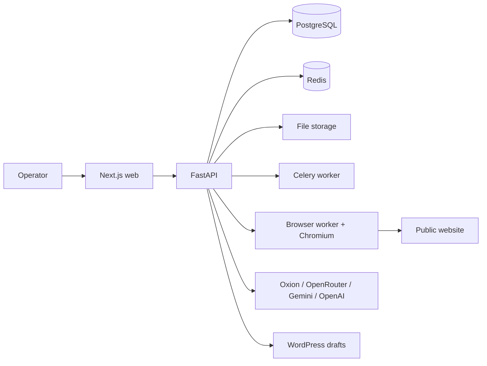
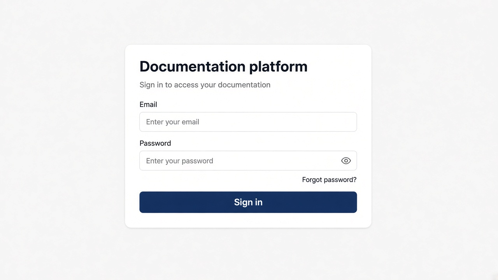
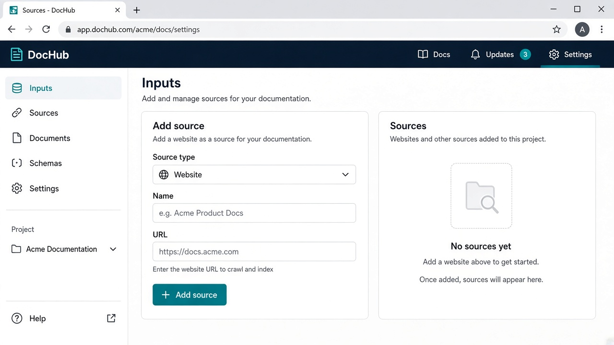
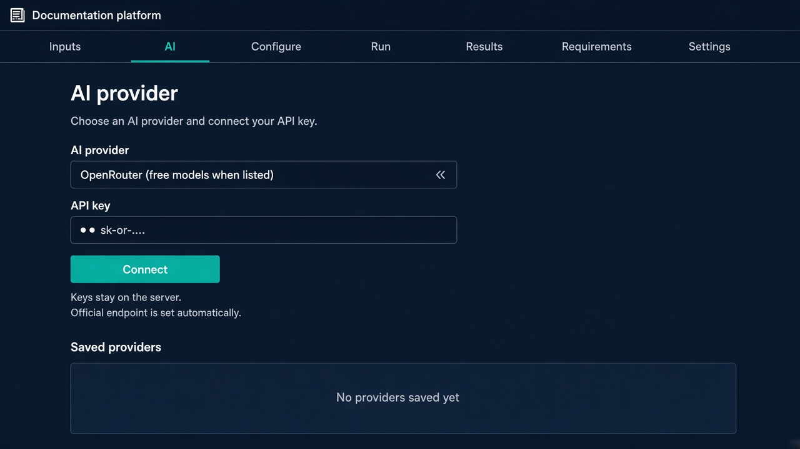
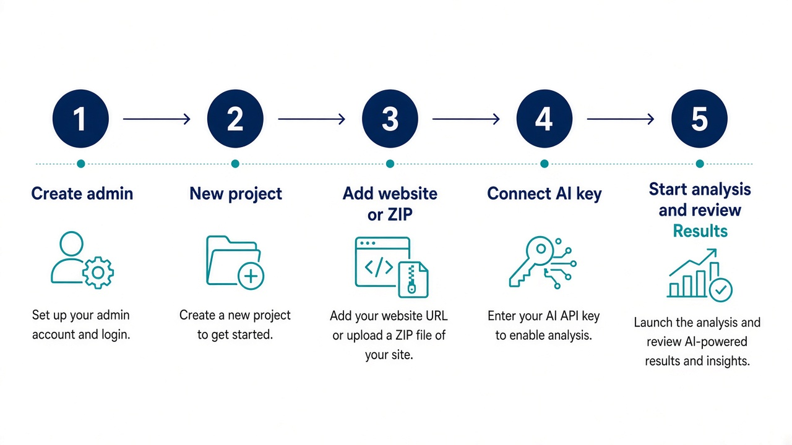

# Nex — Universal AI Documentation Platform (PRS 3.0)

**Nex** is a self-hosted platform that watches a real website or source archive, records what it observed, and turns those observations into documentation, screenshots, optional video, and SEO drafts.

It does **not** mark an AI provider, document, test, or deployment as successful unless the matching check actually ran.

| | |
|---|---|
| License | [GPL-3.0-only](LICENSE) |
| Repository | [github.com/Mostafijemon24/Nex](https://github.com/Mostafijemon24/Nex) |
| Stack | Next.js 16 (web) · FastAPI (API) · PostgreSQL · Redis · Celery workers · Playwright · ffmpeg |

---

## What this repository is for

Teams that ship WordPress sites, plugins, or other products often need **accurate manuals**, not marketing copy invented by a model. Nex:

1. Crawls an **allowed public website** (or inspects a Git repo / ZIP) inside a locked-down browser.
2. Stores pages, screenshots, features, and file hashes in **your** database.
3. Writes documentation from **observed facts**.
4. Optionally asks a connected AI (OpenRouter free models, Google Gemini, Oxion AI, OpenAI, Anthropic, or a custom OpenAI-compatible endpoint) to draft an **SEO article**. Template drafts are labeled `template_fallback`. Model drafts are labeled `ai` only after a real provider response.

API keys stay encrypted on the server. The UI never shows the full key.

---

## How it works




| Service | Role |
|---|---|
| `web` | Operator UI. In Docker, `/api/*` is proxied to the API so the session cookie stays same-origin. |
| `api` | Auth, projects, providers, jobs, documents, publishing. |
| `worker` | Default Celery queue + Beat (scheduled rescans about once a minute). |
| `browser-worker` | Playwright discovery on the `browser` queue. |
| PostgreSQL | Application data. |
| Redis | Queue broker and rate limits. |

**Analysis pipeline (eight steps):** validate inputs → discover site → inspect code → record features → compare previous run → write documents → optional video → finish job. Older documents are kept.

**AI:** Provider HTTP lives in `apps/api/app/integrations/providers.py`. For OpenRouter, Gemini, Oxion, OpenAI, and Anthropic you only paste an API key and click **Connect**. The official base URL is filled in automatically. OpenRouter defaults to the **Free Models Router** (`openrouter/free`) when listed, discovers every **zero-price** chat model, lets you pick any free model in the UI, and falls back only to other free models on generation. Gemini prefers a **flash** model. Another provider is used as fallback only when you explicitly allow paid fallback.

**Safety:** Outbound URLs are SSRF-checked (no cloud metadata / link-local). Website text is treated as untrusted and cannot add pipeline tools. Uploaded code is inspected, not executed.

---

## Screens: what you will see

### 1. First administrator / sign in

The first visit creates the owner account when the database has no users. After that, sign in with email and password.



### 2. Add a source

Create a **project**, then on **Inputs** add a website, GitHub/Git URL, or ZIP (plugin/theme/source).



### 3. Connect AI (optional, but needed for model-written SEO)

Open the **AI** tab. Choose **OpenRouter**, **Google Gemini**, **Oxion AI**, **OpenAI**, or **Anthropic**. Paste only the API key. Click **Connect**. Do not type a Base URL or Model ID for those providers.



Custom OpenAI-compatible servers still need an endpoint.

### 4. Configure, run, review

| Tab | Purpose |
|---|---|
| **Configure** | Crawl limits, doc types, formats, which connected AI provider this project uses. |
| **Run** | Start analysis; pause / resume / retry. |
| **Results** | Pages, features, documents, screenshots, videos, SEO article form. |
| **Requirements** | Catalog status (platform vs this project). |
| **Settings** | Storage probe, extra users, WordPress destination. |



---

## How to use it (operator guide)

### A. Run locally with Docker

You need Docker (and Compose). PostgreSQL, Redis, Playwright, and ffmpeg are inside the images.

```bash
git clone https://github.com/Mostafijemon24/Nex.git
cd Nex
./scripts/prepare-env.sh
docker compose up --build
```

- Web: http://localhost:3000  
- API: http://localhost:8000  
- OpenAPI: http://localhost:8000/docs  

`prepare-env.sh` copies `.env.example` and fills `SECRET_KEY` and `CREDENTIAL_ENCRYPTION_KEY` if they are empty. **Never commit `.env`.**

### B. First-run checklist

1. Open the web UI and create the administrator (email + password at least 12 characters).
2. Create a project.
3. **Inputs** → add a **public** website URL (private/loopback URLs are rejected unless you are in a test env).
4. Optional: **AI** → Connect OpenRouter (`sk-or-…` from [openrouter.ai](https://openrouter.ai)) or Gemini (Google AI Studio).
5. **Configure** → pick documentation types and the connected provider.
6. **Run** → **Start analysis**. Wait until the job completes.
7. **Results** → download documents. For an SEO draft, fill keyword + topic and create an article (uses a connected provider when available).

### C. Free / low-cost AI

| Provider | What you paste | What the app does |
|---|---|---|
| OpenRouter | API key | Official `https://openrouter.ai/api/v1`; prefers models whose **pricing fields are zero**. |
| Google Gemini | AI Studio key | Official Gemini endpoint; prefers a flash model. |
| Oxion AI | Key starting with `cc_` | Official `https://www.oxionai.com/v1`. |
| OpenAI / Anthropic | Vendor key | Official endpoints. |
| OpenAI-compatible | Key **and** base URL | For self-hosted or other vendors. |

A valid key is not enough if the vendor is in maintenance, the free quota is exhausted, or the model is not allowed on that key. Failures return a clear category (invalid key, quota, rate limit, outage) — not an unhandled HTTP 500.

### D. WordPress drafts

In **Settings**, save a site URL, username, and application password, then test. Publishing creates a **draft** only after WordPress confirms the post.

### E. Useful commands

```bash
make up          # prepare-env + compose up --build
make test        # pytest in the API image against an isolated *_test database
make logs
make down        # keeps volumes
make rebuild
```

Or:

```bash
docker compose up -d postgres redis
docker compose run --rm --no-deps -e REQUIRE_WORKERS=false api pytest
```

---

## Environment

See [`.env.example`](.env.example). Compose overrides `DATABASE_URL` and `REDIS_URL` to use Docker service names.

| Variable | Notes |
|---|---|
| `APP_ENV` | `production` refuses default DB passwords and short secrets. |
| `SECRET_KEY` | Session signing. |
| `CREDENTIAL_ENCRYPTION_KEY` | Fernet key for stored API keys and passwords. |
| `ALLOW_LOCAL_TARGETS` | `false` in production. Blocks loopback/private targets. |
| `COOKIE_SECURE` | `true` behind HTTPS. |
| `PUBLIC_APP_URL` | Public origin (also sent as OpenRouter HTTP-Referer). |

`ALLOW_LOCAL_TARGETS=true` is for automated tests. Link-local and cloud metadata addresses stay blocked.

---

## Tests and honesty rules

API tests rewrite `DATABASE_URL` to a name ending in `_test` and **refuse** to truncate the live `docs` database.

```bash
make test
```

Treat `requirements/verification-report.json` as authoritative only when `authoritative_for_current_code` is true on a **clean** Git tree.

There is **no** Playwright E2E suite in this repository. Mocked provider tests are not a substitute for a live Connect + generation against a real vendor key.

---

## Production / VPS

Production layout used in development of this tree:

- App directory: `/opt/prs-nex`
- Web bound to `127.0.0.1:3060`, API health on `127.0.0.1:8060`
- Apache (or Caddy) terminates TLS

Details: [`DEPLOYMENT.md`](DEPLOYMENT.md), [`docs/STAGING.md`](docs/STAGING.md), Hostinger overlay [`docker-compose.hostinger.yml`](docker-compose.hostinger.yml), rollback [`docs/HOSTINGER-ROLLBACK.md`](docs/HOSTINGER-ROLLBACK.md).

Generic VPS with Caddy:

```bash
./scripts/prepare-env.sh
# edit .env: APP_ENV=production, strong POSTGRES_PASSWORD, APP_DOMAIN, COOKIE_SECURE=true
docker compose -f docker-compose.yml -f docker-compose.production.yml up -d --build
```

Backup:

```bash
./scripts/backup.sh
```

Do not publish Postgres/Redis to the internet. Do not replace unrelated apps on the same host (this project’s Hostinger notes explicitly preserve other services).

---

## Project layout

```
apps/web/          Next.js operator UI
apps/api/          FastAPI, workers, Playwright, tests
requirements/      Requirement catalog + acceptance criteria
deployment/        Dockerfiles, Caddy, Railway snippets
docs/              Licensing, staging, rollback, README images
scripts/           prepare-env, backup, secret-scan
```

Architecture notes: [`ARCHITECTURE.md`](ARCHITECTURE.md) · Security: [`SECURITY.md`](SECURITY.md)

---

## Troubleshooting

- API exits at startup: run `./scripts/prepare-env.sh` (missing `SECRET_KEY` / Fernet key).
- `/health/ready` is 503 until Postgres, Redis, storage, and both workers heartbeat.
- Website URL rejected: private or metadata address — expected.
- Connect fails with HTTP 401: paste a **new** vendor key; do not click Test on a failed row (it reuses the rejected secret).
- Generation 502 with “outage or maintenance”: the vendor is down; try OpenRouter/Gemini or wait.
- PDF needs DejaVu in the API image; video needs ffmpeg and at least one PNG.

---

## License

Copyright (C) 2026 Mostafijemon24

This program is free software under the **GNU General Public License version 3 only** (`GPL-3.0-only`). See [`LICENSE`](LICENSE) and [`docs/LICENSING.md`](docs/LICENSING.md).

Third-party packages keep their own licenses. WordPress, OpenRouter, Google, Oxion, and other remote APIs are used under **their** terms; your API keys and usage bills are not covered by this GPL.
