# Nex — Universal AI Documentation Platform (PRS 3.0)

**Nex** is a self-hosted platform that watches a real website or source archive, records what it observed, and turns those observations into documentation, screenshots, optional video, and SEO drafts.

It does **not** mark an AI provider, document, test, or deployment as successful unless the matching check actually ran.

| | |
|---|---|
| License | [GPL-3.0-only](LICENSE) |
| Repository | [github.com/Mostafijemon24/Nex](https://github.com/Mostafijemon24/Nex) |
| Stack | Next.js 16 (web) · FastAPI (API) · PostgreSQL · Redis · Celery workers · Playwright · ffmpeg |

---

## What this repository is for

Teams that ship WordPress sites, plugins, or other products often need **accurate manuals**, not marketing copy invented by a model. Nex:

1. Crawls an **allowed public website** (or inspects a Git repo / ZIP) inside a locked-down browser.
2. Stores pages, screenshots, features, and file hashes in **your** database.
3. Writes documentation from **observed facts**.
4. Optionally asks a connected AI (OpenRouter free models, Google Gemini, Oxion AI, OpenAI, Anthropic, or a custom OpenAI-compatible endpoint) to draft an **SEO article**. Template drafts are labeled `template_fallback`. Model drafts are labeled `ai` only after a real provider response.

API keys stay encrypted on the server. The UI never shows the full key.

---

## How it works

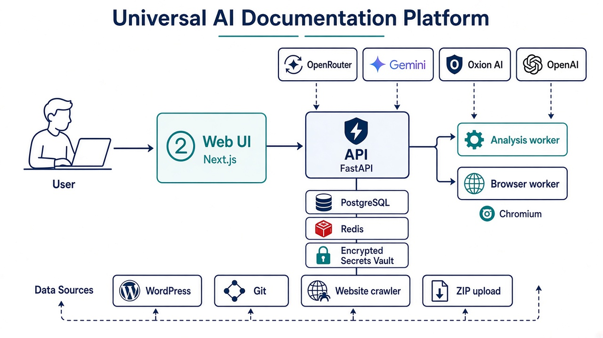

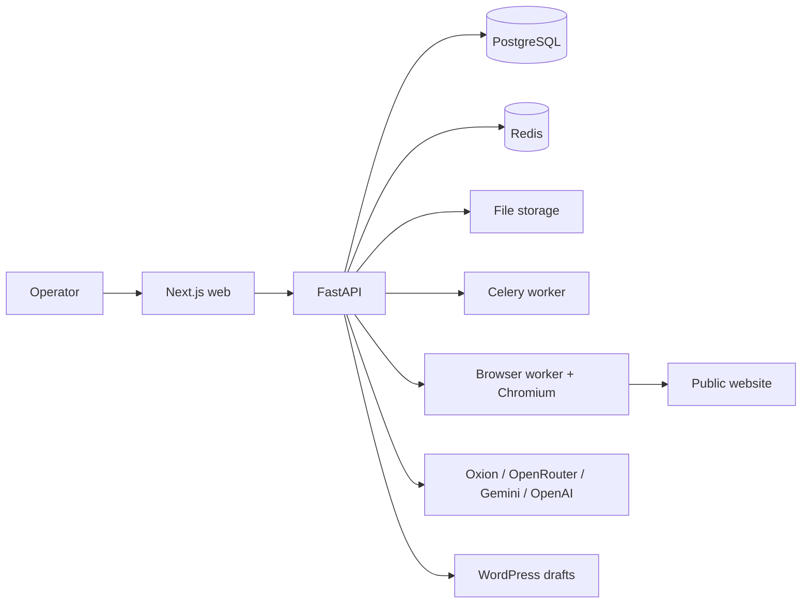

| Service | Role |
|---|---|
| `web` | Operator UI. In Docker, `/api/*` is proxied to the API so the session cookie stays same-origin. |
| `api` | Auth, projects, providers, jobs, documents, publishing. |
| `worker` | Default Celery queue + Beat (scheduled rescans about once a minute). |
| `browser-worker` | Playwright discovery on the `browser` queue. |
| PostgreSQL | Application data. |
| Redis | Queue broker and rate limits. |

**Analysis pipeline (eight steps):** validate inputs → discover site → inspect code → record features → compare previous run → write documents → optional video → finish job. Older documents are kept.

**AI:** Provider HTTP lives in `apps/api/app/integrations/providers.py`. For OpenRouter, Gemini, Oxion, OpenAI, and Anthropic you only paste an API key and click **Connect**. The official base URL is filled in automatically. OpenRouter defaults to the **Free Models Router** (`openrouter/free`) when listed, discovers every **zero-price** chat model, lets you pick any free model in the UI, and falls back only to other free models on generation. Gemini prefers a **flash** model. Another provider is used as fallback only when you explicitly allow paid fallback.

**Safety:** Outbound URLs are SSRF-checked (no cloud metadata / link-local). Website text is treated as untrusted and cannot add pipeline tools. Uploaded code is inspected, not executed.

---

## Dashboard tour

> The images and video below show the dashboard with **example data** (a sample site called `acme.example`). In your installation every number, screenshot and document comes from your own analysis runs.

### Walkthrough video

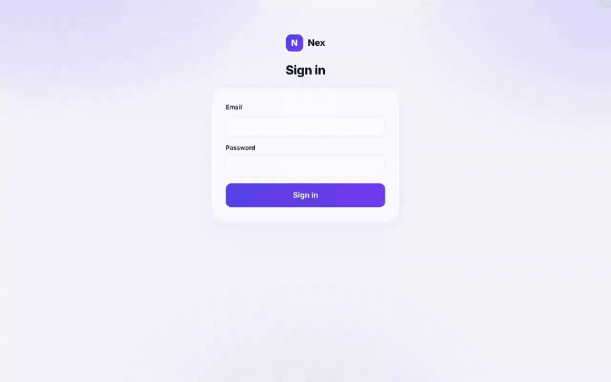

[Download the walkthrough as MP4 (31 s)](docs/images/dashboard/walkthrough.mp4)

### Main menu

The top bar has five sections. Everything else is a step inside them.

| Menu | What it is for |
|---|---|
| **Analyze** | A 4-step wizard: Source → Configure → Run → Results. |
| **Results** | Documents, screenshots, video, SEO article and change report. |
| **API** | Connect an AI provider with your own key (optional). |
| **Requirements** | Which requirements are verified, with acceptance criteria and evidence. |
| **Settings** | WordPress drafts, automatic rescans, storage and team members. |

The project picker on the right switches projects or starts a new one.

### Step guide (skippable)

On the first visit a short 4-step guide explains the flow. Click **Skip guide** to close it, or open it again later with **Guide**.

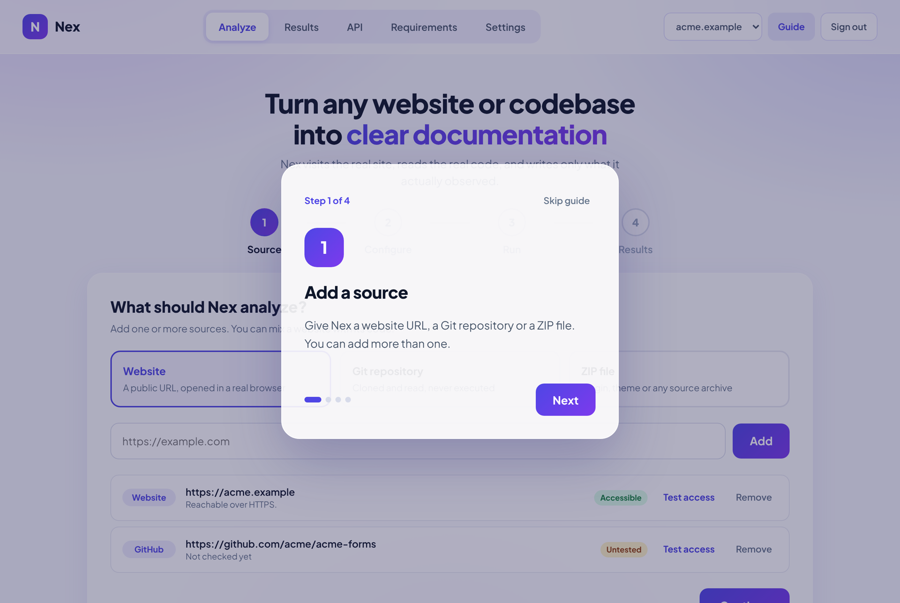

### Analyze — 1. Source

Add a public website, a Git repository, or a ZIP file (source code, WordPress plugin or theme). You can mix a website with its code. **Test access** checks each source. Private and internal addresses are refused.

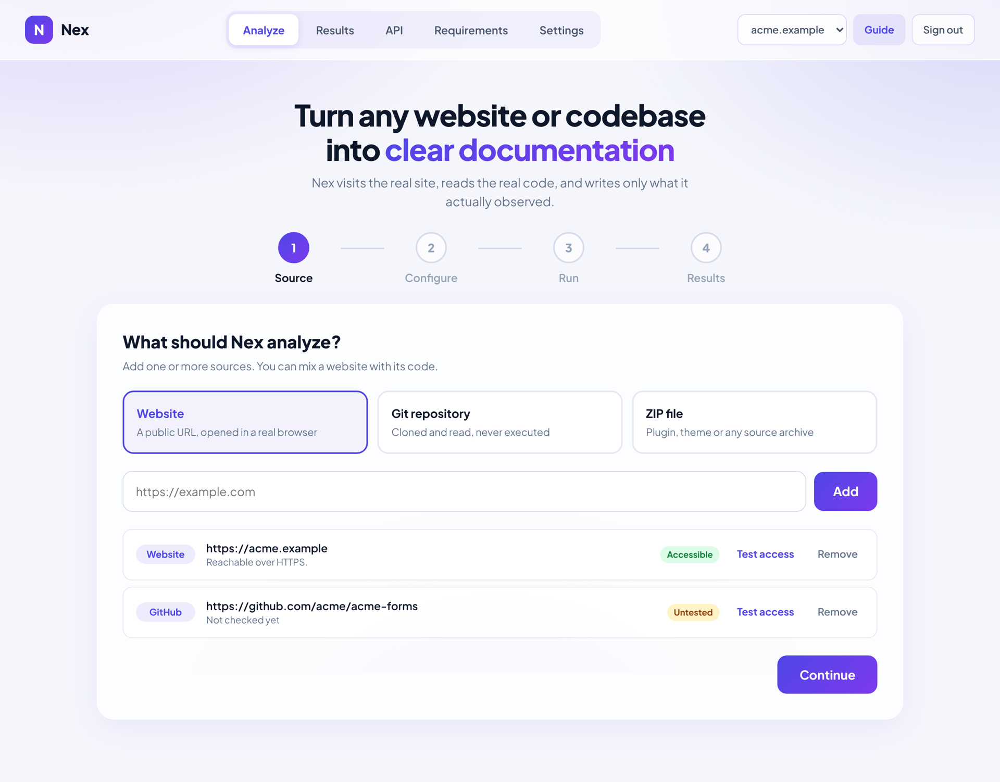

### Analyze — 2. Configure

Pick the documents and export formats (Markdown, HTML, PDF, DOCX), turn the MP4 walkthrough on or off, set how many pages to crawl (up to 30), and choose an AI provider or none. **Advanced** holds analysis mode, safety level, language, audience, allowed domains, limits and speech settings.

Screenshots are lossless PNG at the browser viewport the server uses (1280×720). The form says so instead of offering resolutions the server cannot produce.

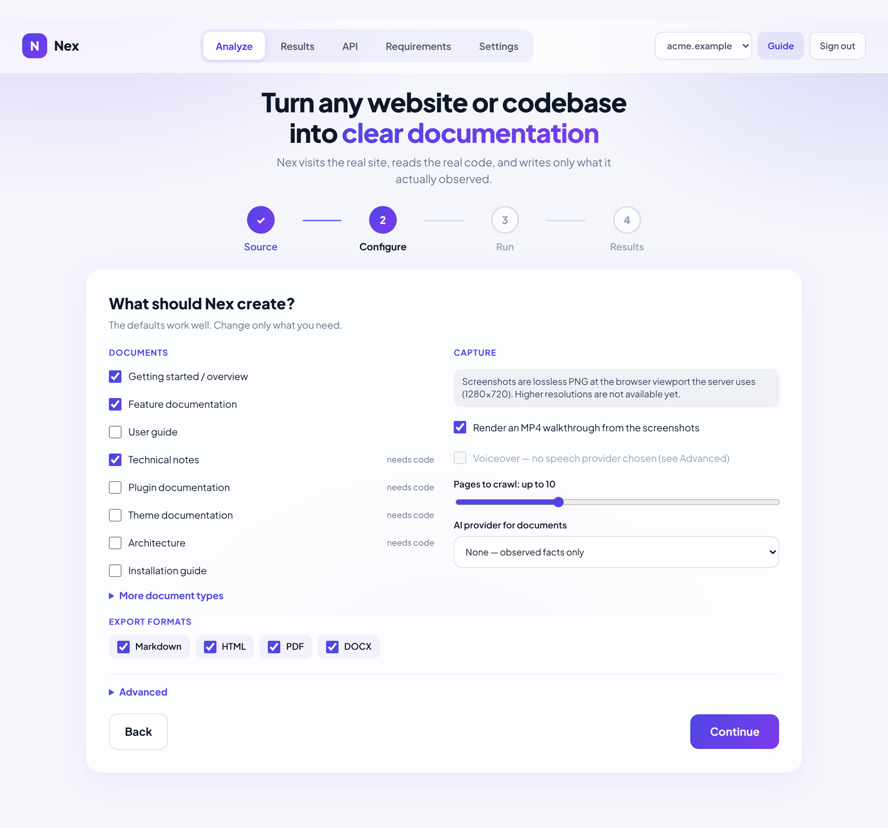

### Analyze — 3. Run

Start the analysis and watch each of the eight steps finish. **Pause**, **Resume**, **Cancel** and **Retry** work while a job is active. A failed job stays failed and is never shown as complete. Earlier runs are listed below with a **Retry** button.

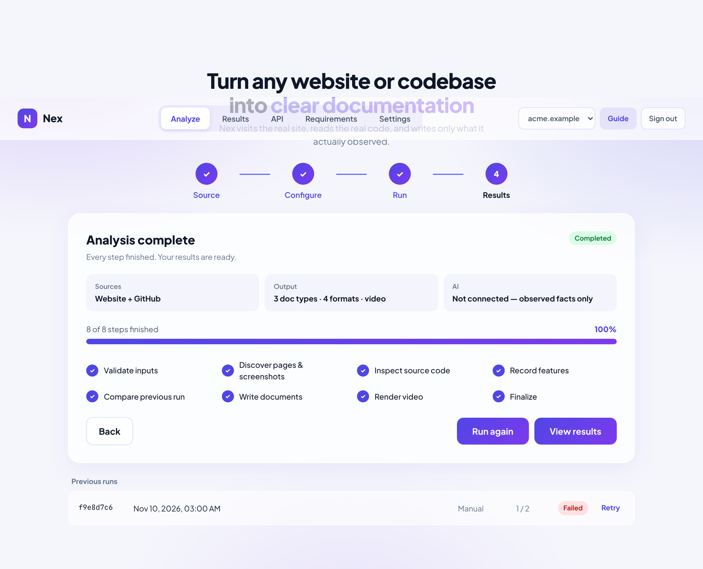

### Results — Documents

Every section of a document carries a tag: **Observed**, **Source code**, **Blocked — not observed**, or **AI inference · not verified**. Download any format from the bar at the top.

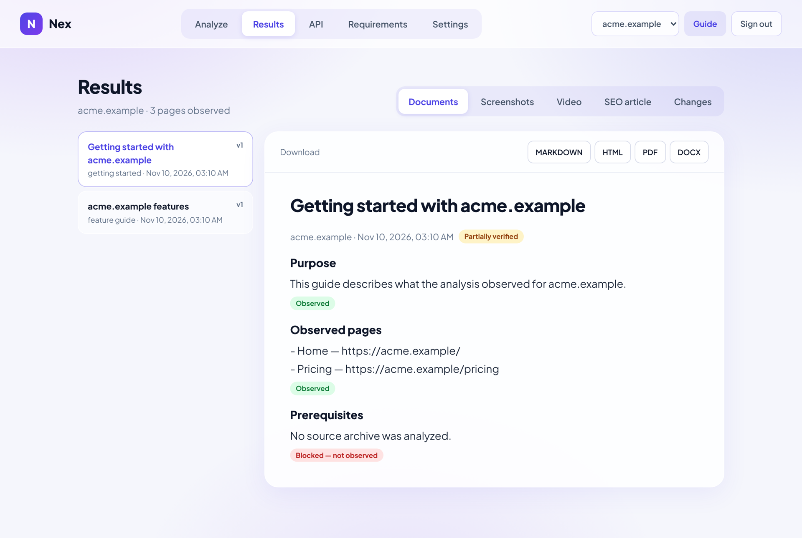

### Results — Screenshots

A gallery of the captured pages. Pages that are new since the previous run are marked **New**.

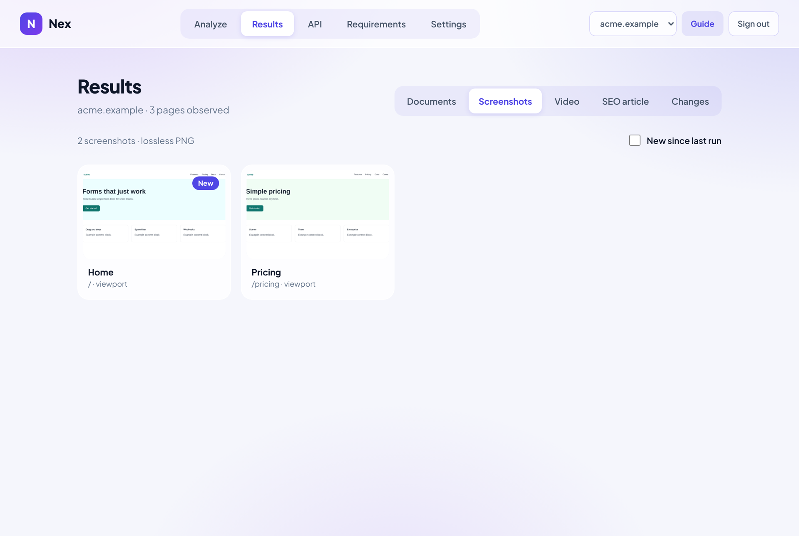

Open a capture to see it full size, download the PNG, or **Compare with last run** side by side.

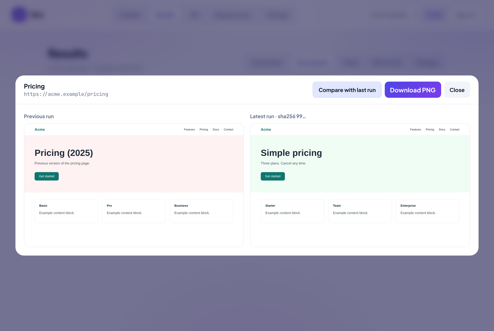

### Results — Video

The walkthrough MP4 rendered with ffmpeg. It is always labelled as a screenshot slideshow, never as a live browser recording. Any limits (for example a silent video) are listed.

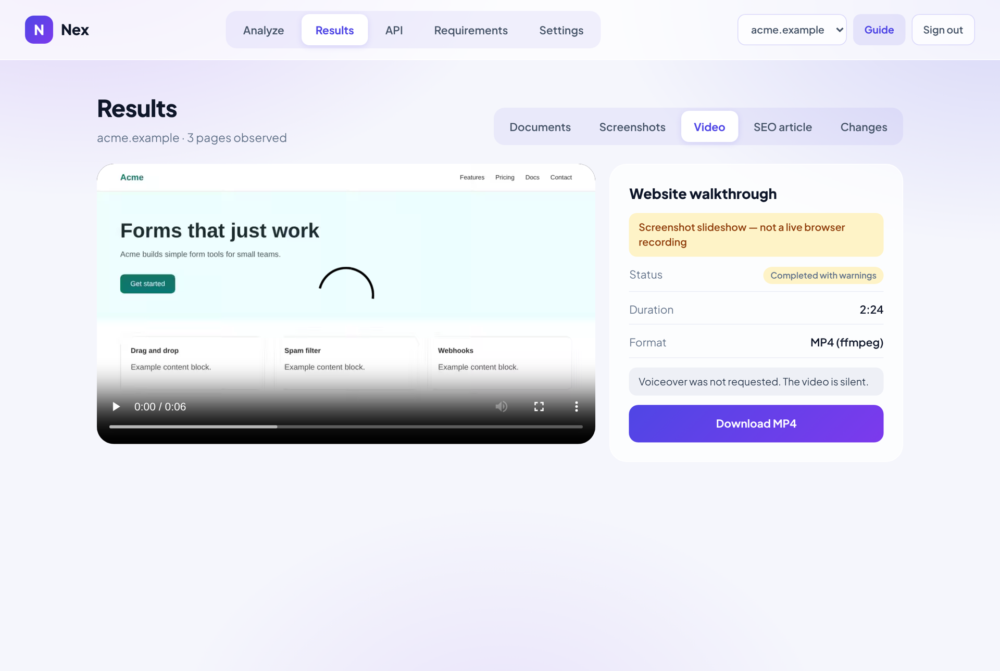

### Results — SEO article and Changes

**SEO article** writes a draft from the pages recorded in the project. A draft is labelled **AI-generated** only when a real provider answered; otherwise it is labelled **Template output — not AI-generated**. **Send to WordPress as draft** reports success only after WordPress confirms the post.

**Changes** compares the latest run with the previous one: new and removed pages, and source files changed, added or removed (compared by SHA-256).

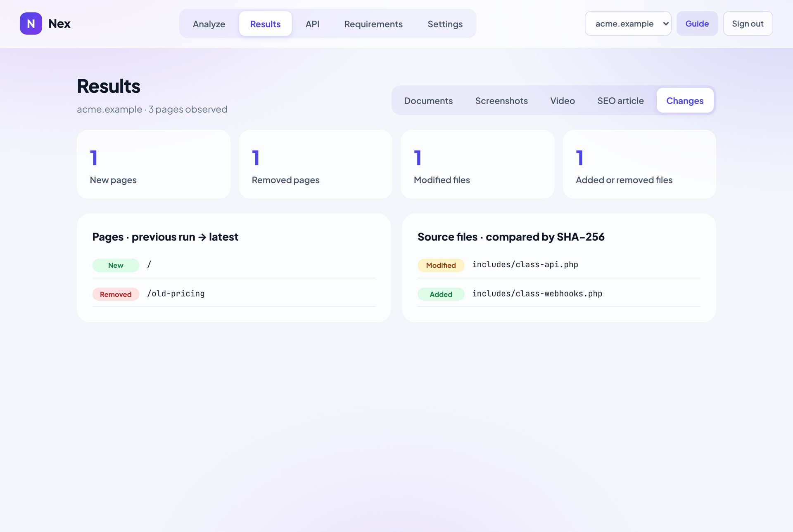

### API

One card per provider: OpenRouter, Google Gemini, Oxion AI, OpenAI, Anthropic and a custom OpenAI-compatible endpoint. Paste a key and click **Connect**. Connected cards can be tested, list models, pick a free OpenRouter model, or be removed. **Allow paid fallback** is off by default.

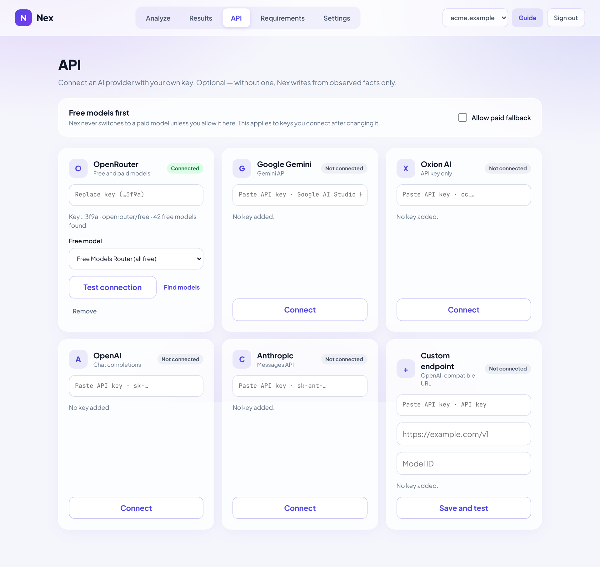

### Requirements

Filter by status and open a row to see its acceptance criteria, code references and evidence. A requirement becomes **Verified** only from recorded test runs; it cannot be ticked by hand. Requirements with blockers are listed under **Still open before release**.

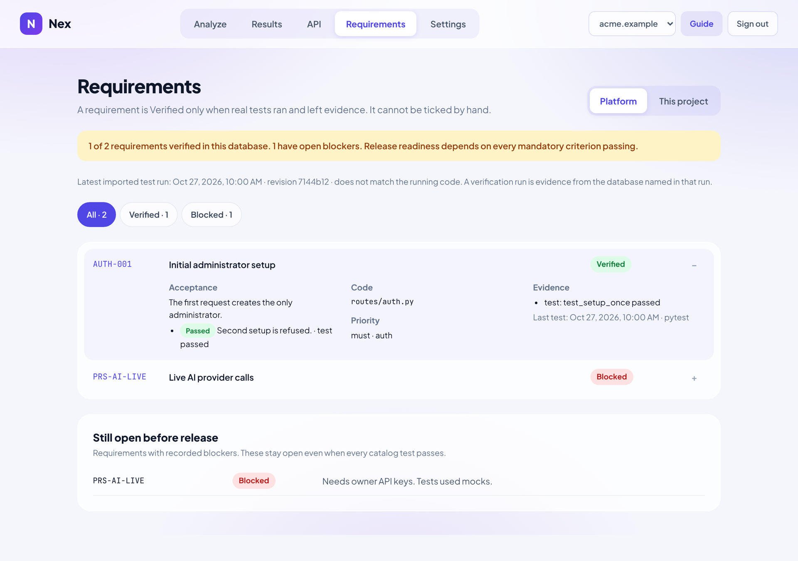

### Settings

Connect a WordPress site (site URL, username, application password) and test it, turn on automatic rescans for the current project, test storage, and add team members.

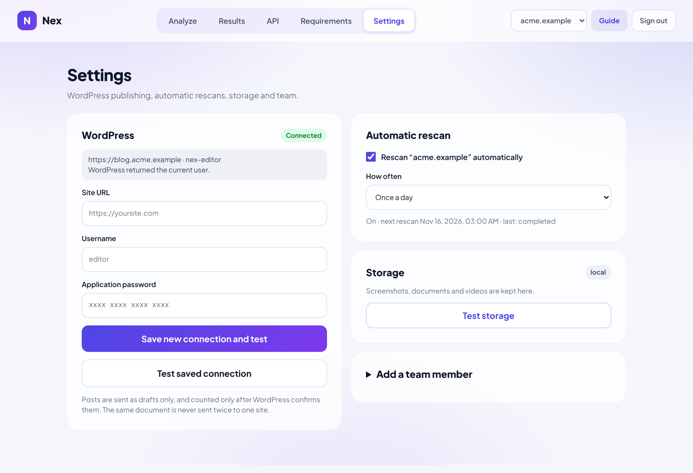

### On a phone

The layout adapts to small screens without sideways scrolling.

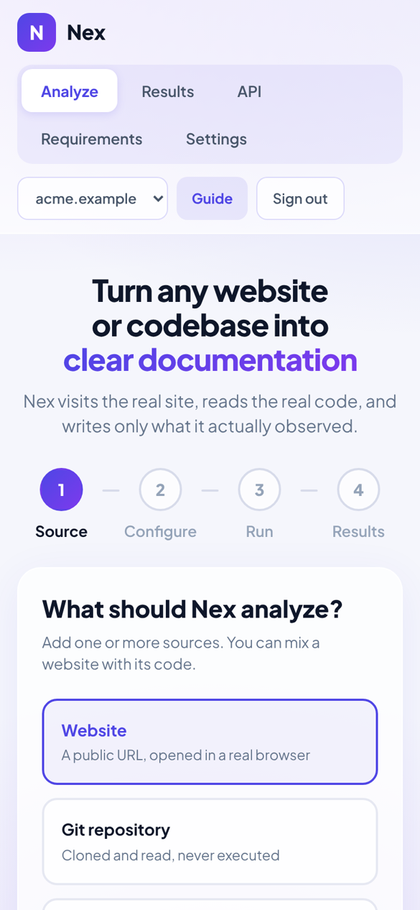

---

## How to use it (operator guide)

### A. Run locally with Docker

You need Docker (and Compose). PostgreSQL, Redis, Playwright, and ffmpeg are inside the images.

```bash
git clone https://github.com/Mostafijemon24/Nex.git
cd Nex
./scripts/prepare-env.sh
docker compose up --build
```

- Web: http://localhost:3000  
- API: http://localhost:8000  
- OpenAPI: http://localhost:8000/docs  

`prepare-env.sh` copies `.env.example` and fills `SECRET_KEY` and `CREDENTIAL_ENCRYPTION_KEY` if they are empty. **Never commit `.env`.**

### B. First-run checklist

1. Open the web UI and create the administrator (email + password at least 12 characters).
2. **Analyze → Source**: add a **public** website URL, a Git URL or a ZIP. A project is created for you (private/loopback URLs are rejected unless you are in a test env).
3. Optional: **API** → paste an OpenRouter (`sk-or-…` from [openrouter.ai](https://openrouter.ai)) or Gemini (Google AI Studio) key and click **Connect**.
4. **Analyze → Configure**: pick documents, formats and the connected provider, then **Continue**.
5. **Analyze → Run**: **Start analysis** and wait until every step is done.
6. **Results**: read and download documents, screenshots and video. For an SEO draft, fill keyword + topic on **SEO article**.

### C. Free / low-cost AI

| Provider | What you paste | What the app does |
|---|---|---|
| OpenRouter | API key | Official `https://openrouter.ai/api/v1`; prefers models whose **pricing fields are zero**. |
| Google Gemini | AI Studio key | Official Gemini endpoint; prefers a flash model. |
| Oxion AI | Key starting with `cc_` | Official `https://www.oxionai.com/v1`. |
| OpenAI / Anthropic | Vendor key | Official endpoints. |
| OpenAI-compatible | Key **and** base URL | For self-hosted or other vendors. |

A valid key is not enough if the vendor is in maintenance, the free quota is exhausted, or the model is not allowed on that key. Failures return a clear category (invalid key, quota, rate limit, outage) — not an unhandled HTTP 500.

### D. WordPress drafts

In **Settings**, save a site URL, username, and application password, then test. Publishing creates a **draft** only after WordPress confirms the post.

### E. Useful commands

```bash
make up          # prepare-env + compose up --build
make test        # pytest in the API image against an isolated *_test database
make logs
make down        # keeps volumes
make rebuild
```

Or:

```bash
docker compose up -d postgres redis
docker compose run --rm --no-deps -e REQUIRE_WORKERS=false api pytest
```

---

## Environment

See [`.env.example`](.env.example). Compose overrides `DATABASE_URL` and `REDIS_URL` to use Docker service names.

| Variable | Notes |
|---|---|
| `APP_ENV` | `production` refuses default DB passwords and short secrets. |
| `SECRET_KEY` | Session signing. |
| `CREDENTIAL_ENCRYPTION_KEY` | Fernet key for stored API keys and passwords. |
| `ALLOW_LOCAL_TARGETS` | `false` in production. Blocks loopback/private targets. |
| `COOKIE_SECURE` | `true` behind HTTPS. |
| `PUBLIC_APP_URL` | Public origin (also sent as OpenRouter HTTP-Referer). |

`ALLOW_LOCAL_TARGETS=true` is for automated tests. Link-local and cloud metadata addresses stay blocked.

---

## Tests and honesty rules

API tests rewrite `DATABASE_URL` to a name ending in `_test` and **refuse** to truncate the live `docs` database.

```bash
make test
```

Treat `requirements/verification-report.json` as authoritative only when `authoritative_for_current_code` is true on a **clean** Git tree.

There is **no** Playwright E2E suite in this repository. Mocked provider tests are not a substitute for a live Connect + generation against a real vendor key.

---

## Production / VPS

Production layout used in development of this tree:

- App directory: `/opt/prs-nex`
- Web bound to `127.0.0.1:3060`, API health on `127.0.0.1:8060`
- Apache (or Caddy) terminates TLS

Details: [`DEPLOYMENT.md`](DEPLOYMENT.md), [`docs/STAGING.md`](docs/STAGING.md), Hostinger overlay [`docker-compose.hostinger.yml`](docker-compose.hostinger.yml), rollback [`docs/HOSTINGER-ROLLBACK.md`](docs/HOSTINGER-ROLLBACK.md).

Generic VPS with Caddy:

```bash
./scripts/prepare-env.sh
# edit .env: APP_ENV=production, strong POSTGRES_PASSWORD, APP_DOMAIN, COOKIE_SECURE=true
docker compose -f docker-compose.yml -f docker-compose.production.yml up -d --build
```

Backup:

```bash
./scripts/backup.sh
```

Do not publish Postgres/Redis to the internet. Do not replace unrelated apps on the same host (this project’s Hostinger notes explicitly preserve other services).

---

## Project layout

```
apps/web/          Next.js operator UI
apps/api/          FastAPI, workers, Playwright, tests
requirements/      Requirement catalog + acceptance criteria
deployment/        Dockerfiles, Caddy, Railway snippets
docs/              Licensing, staging, rollback, README images
scripts/           prepare-env, backup, secret-scan
```

Architecture notes: [`ARCHITECTURE.md`](ARCHITECTURE.md) · Security: [`SECURITY.md`](SECURITY.md)

---

## Troubleshooting

- API exits at startup: run `./scripts/prepare-env.sh` (missing `SECRET_KEY` / Fernet key).
- `/health/ready` is 503 until Postgres, Redis, storage, and both workers heartbeat.
- Website URL rejected: private or metadata address — expected.
- Connect fails with HTTP 401: paste a **new** vendor key; do not click Test on a failed row (it reuses the rejected secret).
- Generation 502 with “outage or maintenance”: the vendor is down; try OpenRouter/Gemini or wait.
- PDF needs DejaVu in the API image; video needs ffmpeg and at least one PNG.

---

## License

Copyright (C) 2026 Mostafijemon24

This program is free software under the **GNU General Public License version 3 only** (`GPL-3.0-only`). See [`LICENSE`](LICENSE) and [`docs/LICENSING.md`](docs/LICENSING.md).

Third-party packages keep their own licenses. WordPress, OpenRouter, Google, Oxion, and other remote APIs are used under **their** terms; your API keys and usage bills are not covered by this GPL.
